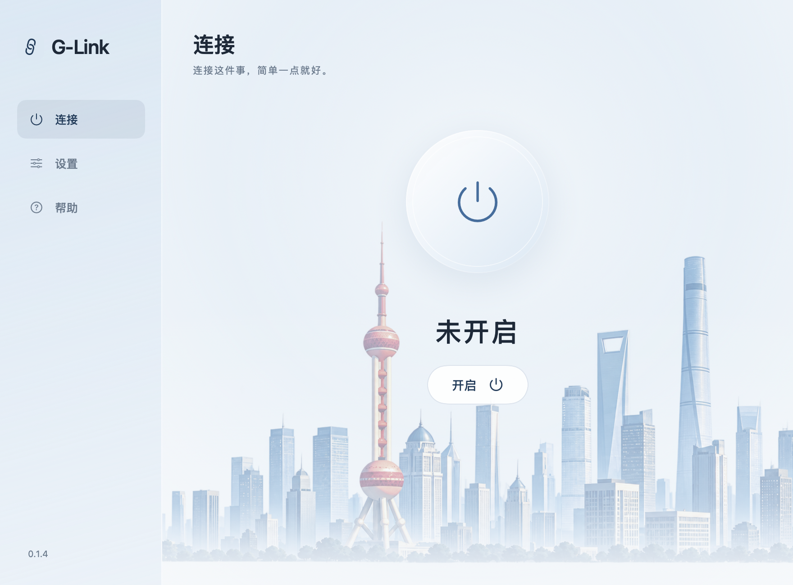

# G-Link

**连接这件事，简单一点就好。**

面向日常使用的 macOS 系统代理小应用。第一次导入配置，以后只需开启、关闭。
SwiftUI 原生界面，城市建筑插画背景，每次启动随机更换城市。开启时切换为深蓝光晕，关闭时恢复浅冰蓝。



## 可以做什么

- 首次设置、配置文件导入、添加到用户的「应用程序」文件夹。
- 一键开启 HTTP / HTTPS / SOCKS 系统代理，关闭或退出时恢复原设置。
- 菜单栏开关、连接检查、异常退出后的恢复入口。
- 本机、局域网与 Tailscale 地址绕过代理。
- 支持 Apple Silicon 和 Intel Mac，最低 macOS 13。

当前没有 TUN、智能分流、订阅管理或按应用分流。系统代理仅影响遵循系统设置的软件。
**本项目不提供服务器、节点或订阅服务；公开版本不包含可直接联网的私人配置。**

## 下载

在 [GitHub Releases](https://github.com/StevenGuo30/G-Link/releases/latest) 下载公开应用 ZIP，完整解压后打开 G-Link。
公开应用需要自行导入有效配置；Apple Silicon 与 Intel 共用同一个包。

## 构建与运行

需要 Mac、Xcode Command Line Tools（Swift 6.1 或兼容版本）。首次没有编译工具时可执行 `xcode-select --install`。

```bash
git clone https://github.com/StevenGuo30/G-Link.git
cd G-Link
bash gui/scripts/build.sh
open dist/G-Link.app
```

构建使用仓库内的 sing-box，并验证 SHA256，无需 Homebrew。接收者使用构建好的应用，不需要安装开发工具。
应用使用本地 ad-hoc 签名，没有 Apple Developer ID 签名或公证；首次允许打开的步骤见[使用指南](docs/使用指南.html)。
网络授权由 macOS 的系统窗口处理，G-Link 不接收或保存管理员密码。

## 第一次使用

1. 打开 G-Link，点击「开始设置」。
2. 导入你已有的 sing-box JSON 配置，扩展名可为 `.json` 或 `.qinglink`。
3. 完成设置后点击「开启」，按系统提示授权。
4. 用完点击「关闭」，或正常退出 G-Link。

配置需要一个监听 `127.0.0.1`、端口在 1024–65535 范围内的 mixed 入站和有效代理出站。
[gui/config.example.json](gui/config.example.json) 仅展示格式，其中的地址不可连接。
当前不直接接受 Clash YAML 或订阅 URL。导入前会校验，失败时不会覆盖原配置。

运行数据保存在 `~/Library/Application Support/QingLink/`。这是旧名称沿用的数据目录，便于已有用户升级；
目录权限为 0700，配置及网络备份为 0600。异常退出后请重新打开应用，先恢复网络再删除数据或卸载。
请先关闭其他系统代理管理器，再开启 G-Link。

## 打包与验证

需要 Python 3 来打包、导出和运行 Python 测试。

```bash
bash gui/scripts/package.sh public
python3 gui/scripts/export-public.py
python3 gui/tests/engine.py
python3 gui/tests/artifacts.py
```

公开应用 ZIP 输出到 `dist/G-Link-公开应用.zip`。本地需要私人分享包时，可自行放置
`config/config.json` 并执行 `bash gui/scripts/package.sh private`；该目录和所有 ZIP 已被 Git 忽略。
也可以通过 `GLINK_PRIVATE_CONFIG=/完整路径/config.json` 指定仓库外的配置文件。
私人包含真实配置，请勿上传公开仓库或 Releases。

自检不改动系统代理。引擎测试使用临时配置和本机 HTTP 服务；实际管理员授权、不同网络服务以及目标应用联网，
仍需要在目标 Mac 验证。GUI 预览可通过以下命令生成：

```bash
dist/G-Link.app/Contents/MacOS/G-Link --render-previews /tmp/g-link-preview
```

## 独立设计预览

构建后可生成一个不包含代理内核的预览应用。顶部工具栏可切换城市和开关效果，预览界面不会修改网络或读取节点配置。

```bash
bash gui/scripts/design-preview.sh
open "dist/G-Link 设计预览.app"
```

四张背景基于提供的城市插画，通过内置 image_gen 提取透明建筑素材；不包含原图的天空和水面。
素材及完整处理提示词位于 `docs/assets/cities/`。开启状态的呼吸光晕遵循 macOS「减少动态效果」设置。

## 目录

| 路径 | 内容 |
| --- | --- |
| `gui/Sources/` | SwiftUI 界面、配置管理、引擎和原生系统代理控制 |
| `gui/scripts/` | 构建、打包、公开导出和独立设计预览 |
| `gui/tests/` | 引擎与分发产物验证 |
| `docs/` | 离线教程与配套素材 |
| `bin/` | 官方 sing-box、校验值、许可证及对应版本源码 |

问题反馈请说明系统版本、操作步骤和错误提示；不要附上节点凭据、完整配置或未检查的日志。

## 许可证

G-Link 自有代码、脚本、文档及天际线插画使用 [MIT](LICENSE)。
sing-box 保持其原有 GPL 许可证，具体来源、许可及对应源码见 [第三方说明](THIRD_PARTY_NOTICES.md)。
